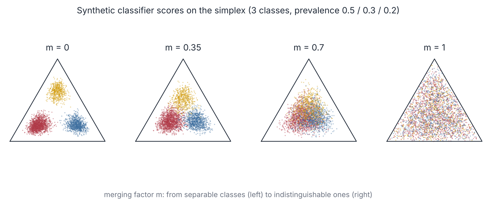
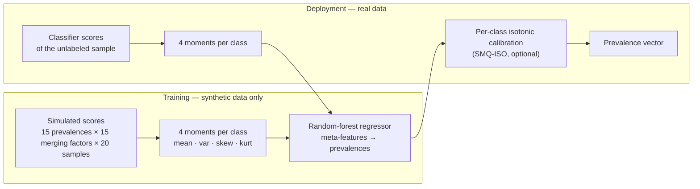
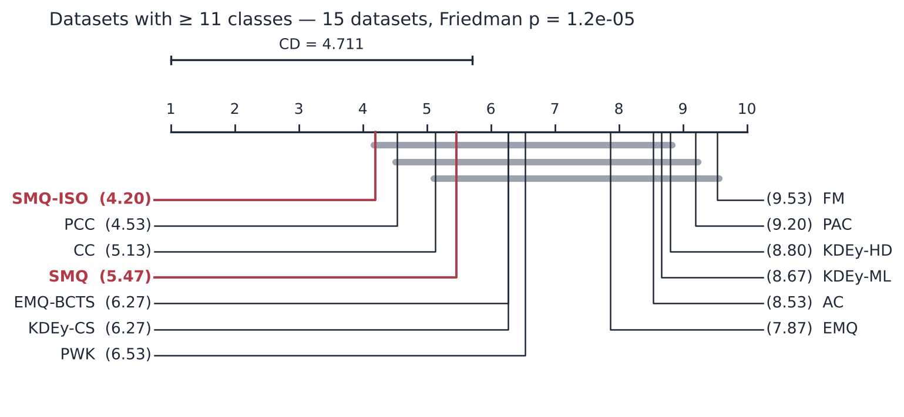
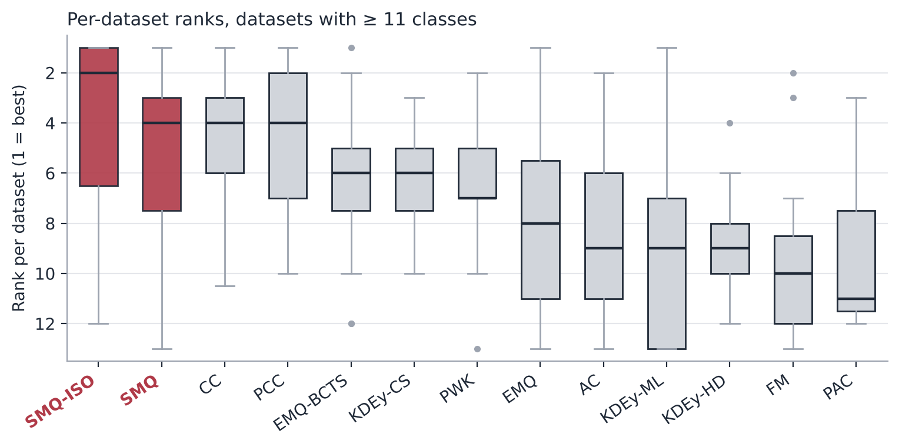
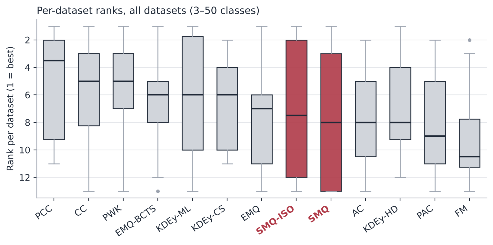
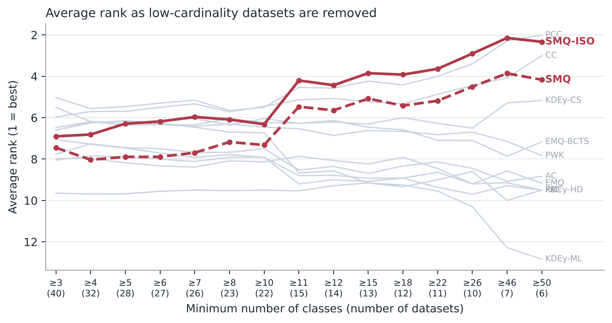
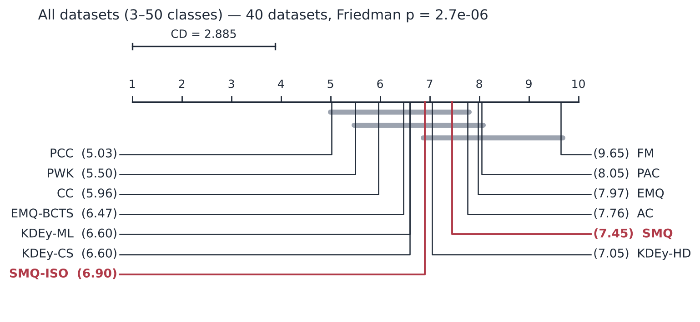

<div align="center">

# SMQ — Synthetic Score Meta-Learning for Multiclass Quantification

**Learning to estimate class prevalences from synthetic classifier scores.**

[](#citation)
[](pyproject.toml)
[](LICENSE)
[](https://github.com/WoolierBrooks/smq/actions/workflows/tests.yml)
[](#reproducing-the-paper)

Julio Cesar Riveros Cardus¹ · André Gustavo Maletzke¹ · Willian Zalewski²

<sub>¹ PGEEC, Universidade Estadual do Oeste do Paraná (UNIOESTE) · ² Universidade Federal da Integração Latino-Americana (UNILA)</sub>



</div>

---

**Quantification** estimates *how many* instances of each class an unlabeled sample contains, rather than labelling each instance. It matters wherever the aggregate is the answer — epidemiology, opinion mining, ecology — and it gets hard when the class proportions of the sample differ from the training data (prior probability shift) and when there are many classes.

**SMQ** turns quantification into a meta-learning regression problem:

1. it simulates classifier scores on the probability simplex for thousands of samples with **known** prevalences (a multiclass extension of MoSS);
2. it describes each sample by four statistics of its scores per class — mean, variance, skewness and kurtosis;
3. a regressor learns the map *score statistics → prevalence vector* **using synthetic data only**;
4. optionally, a light per-class isotonic calibration fitted on real data closes the synthetic-to-real gap (**SMQ-ISO**).



## Installation

```bash
pip install "git+https://github.com/WoolierBrooks/smq.git"
```

The package needs only NumPy, SciPy and scikit-learn. To run the experiments and rebuild the figures:

```bash
git clone https://github.com/WoolierBrooks/smq.git && cd smq
pip install -e ".[experiments,analysis,dev]"
```

## Quickstart

```python
from sklearn.datasets import load_digits
from sklearn.model_selection import train_test_split
from smq import SMQ

X, y = load_digits(return_X_y=True)
X_train, X_test, y_train, y_test = train_test_split(X, y, stratify=y, random_state=0)

q = SMQ(random_state=0).fit(X_train, y_train)  # SMQ-ISO; calibrate=False gives plain SMQ
q.predict(X_test)        # ndarray with one prevalence per class, summing to 1
q.predict_dict(X_test)   # {class_label: prevalence}
q.aggregate(scores)      # estimate straight from a matrix of classifier scores
```

[`examples/quickstart.py`](examples/quickstart.py) evaluates SMQ on shifted test samples next to Classify & Count. On easy problems where the classifier is nearly perfect, as in this example, Classify & Count is very hard to beat; the regime SMQ targets is many classes, discussed below.

| Parameter | Default | Meaning |
|---|---|---|
| `classifier` | `RandomForestClassifier(300)` | probabilistic classifier that produces the scores |
| `calibrate` | `True` | fit the isotonic calibration (SMQ-ISO) |
| `n_prevalences`, `n_merging`, `n_replicates`, `sample_size` | `15, 15, 20, 100` | size of the synthetic training set |
| `synthetic` | `None` | pre-computed synthetic curves, e.g. the files of the paper |
| `calib_prevalences`, `calib_repeats`, `calib_batch_size` | `10, 25, 500` | real calibration batches (UPP over the training set) |

## Results

Benchmark: **40 multiclass datasets with 3 to 50 classes**, 11 baselines (CC, PCC, AC, PAC, EMQ, EMQ-BCTS, KDEy-ML, KDEy-CS, KDEy-HD, FM, PWK), 1000 test samples of 500 instances per dataset drawn with the Uniform Prevalence Protocol, mean absolute error (MAE).

<p align="center"></p>

| From 11 classes on (15 datasets) | Avg. rank | Median rank | Median MAE |
|---|---:|---:|---:|
| **SMQ-ISO** | **4.20** | **2.0** | 0.0252 |
| PCC | 4.53 | 4.0 | 0.0154 |
| CC | 5.13 | 4.0 | 0.0170 |
| **SMQ** | 5.47 | 4.0 | 0.0283 |
| EMQ-BCTS | 6.27 | 6.0 | 0.0183 |
| KDEy-CS | 6.27 | 6.0 | 0.0198 |
| PWK | 6.53 | 7.0 | 0.0214 |

<sub>Full tables for both scopes, with all 13 methods: [`results/summary`](results/summary/README.md).</sub>

What the numbers say:

- **All 40 datasets:** SMQ-ISO (avg. rank 6.90) is statistically indistinguishable from the best-ranked method, PCC (5.03), under the Nemenyi test (CD = 2.885).
- **From 11 classes on:** SMQ-ISO has the best average rank (4.20) and the best median rank (2). With 15 datasets the Nemenyi test (CD = 4.711) separates it significantly from FM and PAC; the remaining differences are not significant.
- **Rank vs. error:** in the same group PCC and CC have lower *median* MAE than SMQ-ISO (0.0154 and 0.0170 against 0.0252), even though SMQ-ISO ranks better. Ranks count how often a method beats the others; the median error weighs by how much.
- **Calibration matters:** without it SMQ is 4th from 11 classes on; with it, 1st. The median MAE over all datasets drops from 0.0639 to 0.0611.

<details>
<summary><b>More figures</b></summary>

<p align="center"></p>
<p align="center"></p>
<p align="center"></p>
<p align="center"></p>

</details>

## Reproducing the paper

Every number above is recomputed from the per-batch results of the original run (`results/raw/exp040_per_batch_mae.csv.gz`, 647,000 rows), and a unit test checks them against the paper.

| Step | Command | Time |
|---|---|---|
| Rebuild tables and figures from the published results | `make figures` | seconds |
| Check the paper's numbers (ranks, CD, medians) | `make test` | seconds |
| Generate the synthetic training curves | `make synthetic` | minutes |
| Re-run the whole benchmark | `make benchmark` | hours (CPU) |

The benchmark downloads the 24 UCI datasets through QuaPy; the 16 additional CSV files go in `data/multiclass/` (list and sources in [`experiments/README.md`](experiments/README.md)). Protocol, hyper-parameters and provenance of every file are documented there as well.

## Repository layout

```
smq/
├── src/smq/              # the method: SMQ estimator, meta-features, simulator, calibration
├── examples/             # quickstart
├── experiments/
│   ├── run_benchmark.py      # benchmark of the paper (cleaned, configurable)
│   ├── generate_synthetic.py # synthetic curves, one file per number of classes
│   └── original/             # the script that produced the published results, verbatim
├── analysis/             # ranks, Friedman/Nemenyi, critical-difference diagrams
├── results/
│   ├── raw/              # per-batch MAE of the published run
│   ├── summary/          # per-dataset MAE, ranks, statistics
│   └── figures/          # PNG + SVG
├── docs/                 # README assets
└── tests/                # unit tests + paper-number regression test
```

## Citation

```bibtex
@inproceedings{riveros2026smq,
  title     = {{SMQ}: Synthetic Score Meta-Learning for Multiclass Quantification},
  author    = {Riveros Cardus, Julio Cesar and Maletzke, Andr{\'e} Gustavo and Zalewski, Willian},
  booktitle = {Ibero-American Conference on Artificial Intelligence (IBERAMIA 2026)},
  address   = {Asunci{\'o}n, Paraguay},
  year      = {2026}
}
```

## Acknowledgements

SMQ builds on MoSS (Maletzke, dos Reis, Hassan & Batista, *Accurately quantifying under score variability*, ICDM 2021). Baselines come from [mlquantify](https://github.com/luizfernandolj/mlquantify) and [QuaPy](https://github.com/HLT-ISTI/QuaPy).

## License

[MIT](LICENSE). Questions and issues: julio.cardus@unioeste.br or the [issue tracker](https://github.com/WoolierBrooks/smq/issues).
